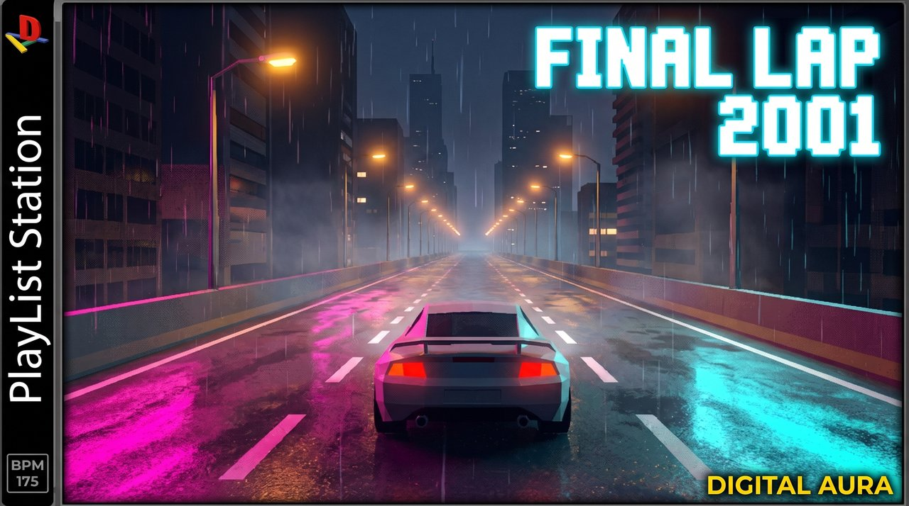
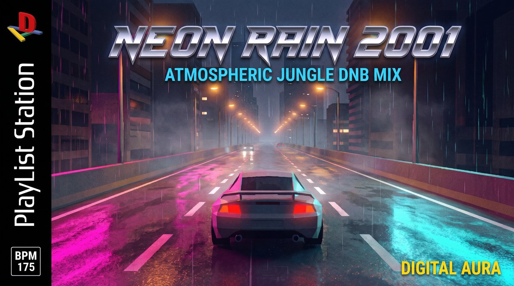

# you're in first place and it's still raining (y2k night drive dnb mix)

- **Date:** 2026-10-21
- **YouTube:** https://youtu.be/C6K1VL3Wf84 (private)
- **Theme:** Neon Rain Night Drive
- **Mix:** 57:30, 26 tracks
- **Loop:** sped up 2.5x, 1.0s seam crossfade
- **Download everything:** [2026-10-21_raw_pack.zip](https://github.com/ctemenes/Music-gen-daily/releases/download/mix-2026-10-21/2026-10-21_raw_pack.zip)

## Files

| File | What | Made with | Size | Full res |
|---|---|---|---|---|
| 01_base_scene_vidiq.png | Base scene from vidIQ (FINAL LAP 2001 cover with side panel) | vidIQ generate_thumbnail | 2.3 MB | [download](https://github.com/ctemenes/Music-gen-daily/releases/download/mix-2026-10-21/raw_01_base_scene_vidiq.png) |
| 02_clean_frame.png | Clean frame, start and end frame of the loop | Higgsfield nano_banana_2_1, 2k | 6.7 MB | [download](https://github.com/ctemenes/Music-gen-daily/releases/download/mix-2026-10-21/raw_02_clean_frame.png) |
| 03_thumbnail.png | YouTube thumbnail (same image as the vidIQ base scene) | vidIQ generate_thumbnail | 2.3 MB | [download](https://github.com/ctemenes/Music-gen-daily/releases/download/mix-2026-10-21/raw_03_thumbnail.png) |
| 03b_thumbnail_final_lap_playlist_station.png | Thumbnail B: the FINAL LAP cover with the PlayList Station spine (made for A/B testing) | Higgsfield nano_banana_pro, 2k, refs: current thumbnail 943b2dd4, layout 8df28182, D-A logo c8227829 | 6.9 MB | [download](https://github.com/ctemenes/Music-gen-daily/releases/download/mix-2026-10-21/raw_03b_thumbnail_final_lap_playlist_station.png) |
| 03c_thumbnail_neon_rain_playlist_station.png | Thumbnail C: NEON RAIN 2001 PlayList Station cover, chrome low-poly title (made for A/B testing) | Higgsfield nano_banana_pro, 2k, refs: layout 8df28182, D-A logo c8227829, clean frame d5c8424b | 8.0 MB | [download](https://github.com/ctemenes/Music-gen-daily/releases/download/mix-2026-10-21/raw_03c_thumbnail_neon_rain_playlist_station.png) |
| 04_loop_raw.mp4 | Raw 15s loop before the 2.5x speed-up and seam crossfade | Higgsfield kling3_0 pro, 15s, sound off, start = end = clean frame | 40.1 MB | [download](https://github.com/ctemenes/Music-gen-daily/releases/download/mix-2026-10-21/raw_04_loop_raw.mp4) |

## Previews

**01_base_scene_vidiq.png**


**02_clean_frame.png**


**03_thumbnail.png**


**03b_thumbnail_final_lap_playlist_station.png**



**03c_thumbnail_neon_rain_playlist_station.png**



## Prompts

### 02_clean_frame.png

Higgsfield nano_banana_2_1, 2k, job `d5c8424b-0356-4856-8152-37454a8f5982`

```
Recreate this exact scene as a clean full-frame image: the same low-poly sports car in the same position and size, same rear chase-camera angle, same elevated expressway, lane markings, buildings, amber streetlights, magenta and cyan neon reflections on the wet road, rain streaks and mist. Remove the grey 'DIGITAL AURA' side panel on the left and the 'FINAL LAP 2001' text, and extend the city, barrier and road naturally across the full width of the frame. Keep the PS1-era low-poly 3D look with low-res dithered textures and soft glow. No text, no logos, no letters, no HUD, no border, no watermark.
```

### 03b_thumbnail_final_lap_playlist_station.png

Higgsfield nano_banana_pro, 2k, refs: current thumbnail 943b2dd4, layout 8df28182, D-A logo c8227829, job `ad1ae7ee-a011-45c7-80ca-f220b499728e`

```
Edit the first reference image and keep it almost exactly the same: the same rainy night city expressway, the same low-poly sports car in the same position and size, the same amber streetlights, magenta and cyan neon reflections on the wet road, rain and mist, and the same glowing cyan pixel-font title FINAL LAP 2001 in the top right, same size, colour and position. Change only the left edge: replace the grey vertical side panel that says DIGITAL AURA with the black vertical spine strip from the second reference image, the same width as the grey panel. On that black spine: the D-A logo from the third reference image at the top (a chunky 3D red capital D standing upright over a yellow bar, a blue bar and a green bar forming a letter A, copied exactly, not any other console logo), the words PlayList Station running vertically up the spine in white, and a small white-outlined box reading BPM 175 at the bottom of the spine. Bottom right corner: DIGITAL AURA in small bold yellow capitals. Spell all text exactly as written. No other console, publisher or rating logos, no ESRB, no Sony, no other text.
```

### 03c_thumbnail_neon_rain_playlist_station.png

Higgsfield nano_banana_pro, 2k, refs: layout 8df28182, D-A logo c8227829, clean frame d5c8424b, job `5c3093d8-811c-4893-8392-3fd8d1158c50`

```
A flat, front-on video game cover that fills the entire 16:9 frame edge to edge, matching the first reference image as closely as possible: the black vertical spine strip down the left side with the D-A logo from the second reference image at the top (a chunky 3D red capital D standing upright over a yellow bar, a blue bar and a green bar forming a letter A, copied exactly, not any other console logo), the words PlayList Station running vertically up the spine in white, and a small white-outlined box reading BPM 175 at the bottom of the spine. The rest of the frame is the cover art: the rainy night city expressway and low-poly sports car from the third reference image, made gritty with film grain, rain and a sense of speed. Across the top, a huge title NEON RAIN 2001 in the exact lettering style of the first reference: thick slanted italic chrome letters built from hard faceted low-poly bevels, mirror chrome with a blue sky reflection on top and a dark horizon line across the middle, sharp angular cuts, a thin dark outline and a soft glow, like a 2001 PlayStation-era racing game logo. Directly under it, in bold electric cyan capitals: ATMOSPHERIC JUNGLE DNB MIX. Bottom right corner: DIGITAL AURA in small bold yellow capitals. Spell all text exactly as written. No other console, publisher or rating logos, no ESRB, no Sony, no other text.
```

### 04_loop_raw.mp4

Higgsfield kling3_0 pro, 15s, sound off, start = end = clean frame, job `4bb48c8e-a729-4b67-b950-1c738b0ef23b`

```
Locked rear chase camera following the low-poly sports car at speed on a rainy neon expressway at night. The car holds its exact position and size in the frame for the whole shot while the road surface, dashed lane markings and amber streetlights stream past toward the camera at a steady speed. The distant car ahead stays far ahead. Rain falls continuously, magenta and cyan neon reflections shimmer and ripple on the wet asphalt, mist drifts, tail lights glow red. Constant speed, no cuts, no camera shake or drift, no new cars or objects, PS1-era low-poly game look throughout. The final frame matches the first frame exactly so the clip loops seamlessly.
```

## Notes

- vidIQ thumbnail prompt was not recorded for this backfill; runs from now on save it.
- Made before the PlayList Station cover was adopted, so the thumbnail is the vidIQ cover itself.

## Also in this folder

`description.txt` and `tracklist.txt` (as uploaded), `youtube.json` (upload record), `brief.json` (the day's theme and music brief).
