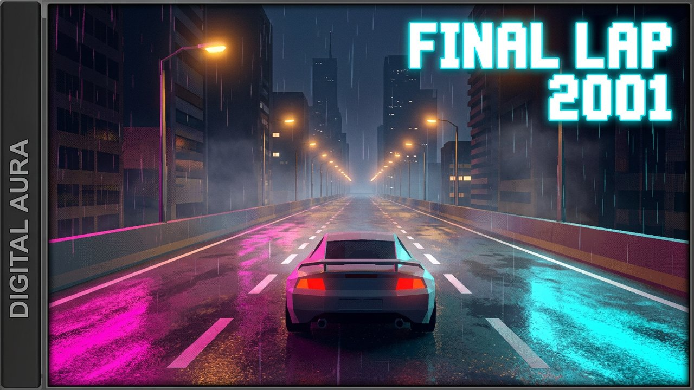
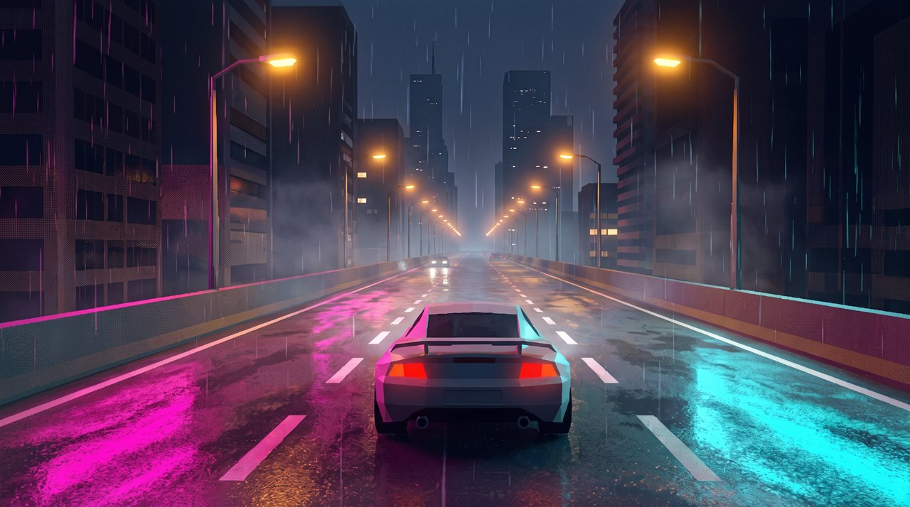

# you're in first place and it's still raining (y2k night drive dnb mix)

- **Date:** 2026-10-21
- **YouTube:** https://youtu.be/C6K1VL3Wf84 (private)
- **Theme:** Neon Rain Night Drive
- **Mix:** 57:30, 26 tracks
- **Loop:** sped up 2.5x, 1.0s seam crossfade
- **Download everything:** [2026-10-21_raw_pack.zip](https://github.com/ctemenes/Music-gen-daily/releases/download/mix-2026-10-21/2026-10-21_raw_pack.zip)

## Files

| File | What | Made with | Size | Full res |
|---|---|---|---|---|
| 01_base_scene_vidiq.png | Base scene from vidIQ (FINAL LAP 2001 cover with side panel) | vidIQ generate_thumbnail | 2.3 MB | [download](https://github.com/ctemenes/Music-gen-daily/releases/download/mix-2026-10-21/raw_01_base_scene_vidiq.png) |
| 02_clean_frame.png | Clean frame, start and end frame of the loop | Higgsfield nano_banana_2_1, 2k | 6.7 MB | [download](https://github.com/ctemenes/Music-gen-daily/releases/download/mix-2026-10-21/raw_02_clean_frame.png) |
| 03_thumbnail.png | YouTube thumbnail (same image as the vidIQ base scene) | vidIQ generate_thumbnail | 2.3 MB | [download](https://github.com/ctemenes/Music-gen-daily/releases/download/mix-2026-10-21/raw_03_thumbnail.png) |
| 04_loop_raw.mp4 | Raw 15s loop before the 2.5x speed-up and seam crossfade | Higgsfield kling3_0 pro, 15s, sound off, start = end = clean frame | 40.1 MB | [download](https://github.com/ctemenes/Music-gen-daily/releases/download/mix-2026-10-21/raw_04_loop_raw.mp4) |

## Previews

**01_base_scene_vidiq.png**



**02_clean_frame.png**



**03_thumbnail.png**


## Prompts

### 02_clean_frame.png

Higgsfield nano_banana_2_1, 2k, job `d5c8424b-0356-4856-8152-37454a8f5982`

```
Recreate this exact scene as a clean full-frame image: the same low-poly sports car in the same position and size, same rear chase-camera angle, same elevated expressway, lane markings, buildings, amber streetlights, magenta and cyan neon reflections on the wet road, rain streaks and mist. Remove the grey 'DIGITAL AURA' side panel on the left and the 'FINAL LAP 2001' text, and extend the city, barrier and road naturally across the full width of the frame. Keep the PS1-era low-poly 3D look with low-res dithered textures and soft glow. No text, no logos, no letters, no HUD, no border, no watermark.
```

### 04_loop_raw.mp4

Higgsfield kling3_0 pro, 15s, sound off, start = end = clean frame, job `4bb48c8e-a729-4b67-b950-1c738b0ef23b`

```
Locked rear chase camera following the low-poly sports car at speed on a rainy neon expressway at night. The car holds its exact position and size in the frame for the whole shot while the road surface, dashed lane markings and amber streetlights stream past toward the camera at a steady speed. The distant car ahead stays far ahead. Rain falls continuously, magenta and cyan neon reflections shimmer and ripple on the wet asphalt, mist drifts, tail lights glow red. Constant speed, no cuts, no camera shake or drift, no new cars or objects, PS1-era low-poly game look throughout. The final frame matches the first frame exactly so the clip loops seamlessly.
```

## Notes

- vidIQ thumbnail prompt was not recorded for this backfill; runs from now on save it.
- Made before the PlayList Station cover was adopted, so the thumbnail is the vidIQ cover itself.

## Also in this folder

`description.txt` and `tracklist.txt` (as uploaded), `youtube.json` (upload record), `brief.json` (the day's theme and music brief).
