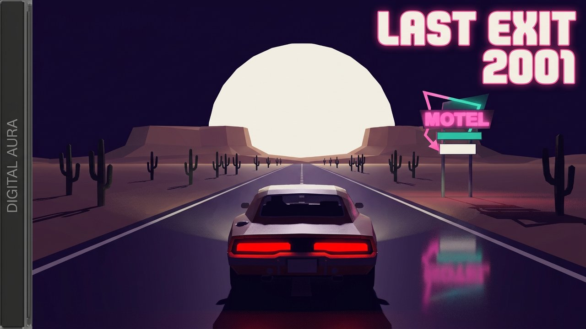
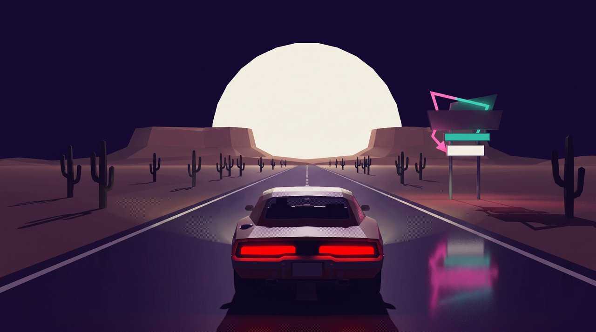
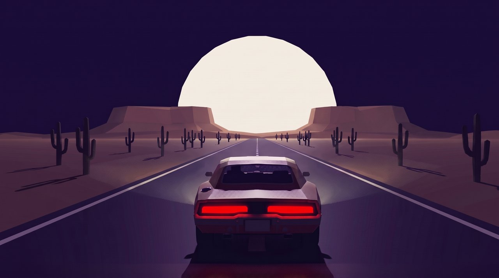
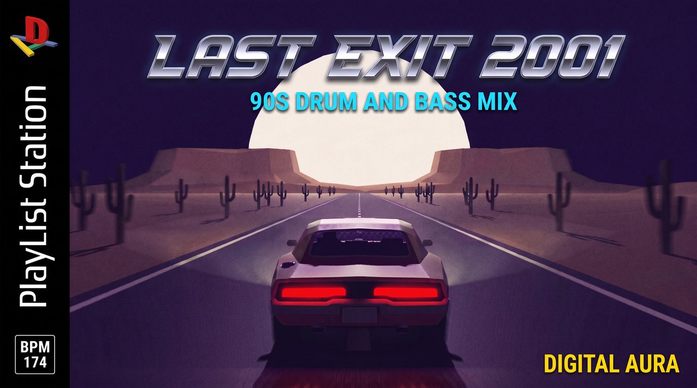

# you're the only car on the road tonight (90s drum and bass)

- **Date:** 2026-10-23
- **YouTube:** https://youtu.be/seFpEKI8ZBU (private, goes public 2026-10-24T08:00:00Z)
- **Theme:** Desert Night Neon
- **Mix:** 44:20, 20 tracks
- **Loop:** sped up 2.5x, 1.0s seam crossfade
- **Download everything:** [2026-10-23_raw_pack.zip](https://github.com/ctemenes/Music-gen-daily/releases/download/mix-2026-10-23/2026-10-23_raw_pack.zip)

## Files

| File | What | Made with | Size | Full res |
|---|---|---|---|---|
| 01_base_scene_vidiq.png | Base scene from vidIQ (LAST EXIT 2001 cover with side panel) | vidIQ generate_thumbnail | 1.4 MB | [download](https://github.com/ctemenes/Music-gen-daily/releases/download/mix-2026-10-23/raw_01_base_scene_vidiq.png) |
| 02a_clean_frame_v1_rejected.png | First clean frame, rejected: the motel sign would repeat in the loop | Higgsfield nano_banana_2_1, 2k | 4.8 MB | [download](https://github.com/ctemenes/Music-gen-daily/releases/download/mix-2026-10-23/raw_02a_clean_frame_v1_rejected.png) |
| 02_clean_frame.png | Clean frame, start and end frame of the loop | Higgsfield nano_banana_2_1, 2k | 4.6 MB | [download](https://github.com/ctemenes/Music-gen-daily/releases/download/mix-2026-10-23/raw_02_clean_frame.png) |
| 03_thumbnail_playlist_station.png | YouTube thumbnail, PlayList Station cover | Higgsfield nano_banana_pro, 2k, refs: layout 8df28182, D-A logo c8227829, clean frame | 7.8 MB | [download](https://github.com/ctemenes/Music-gen-daily/releases/download/mix-2026-10-23/raw_03_thumbnail_playlist_station.png) |
| 04_loop_raw.mp4 | Raw 15s loop before the 2.5x speed-up and seam crossfade | Higgsfield kling3_0 pro, 15s, sound off, start = end = clean frame | 12.8 MB | [download](https://github.com/ctemenes/Music-gen-daily/releases/download/mix-2026-10-23/raw_04_loop_raw.mp4) |

## Previews

**01_base_scene_vidiq.png**



**02a_clean_frame_v1_rejected.png**



**02_clean_frame.png**



**03_thumbnail_playlist_station.png**



## Prompts

### 02a_clean_frame_v1_rejected.png

Higgsfield nano_banana_2_1, 2k, job `a3d6d0e5-cec0-4981-ab0e-58cd7c7260e6`

```
Recreate this exact scene as a clean full-frame image: the same low-poly muscle car in the same position and size, same rear chase-camera angle, same straight desert highway, giant moon, mesas, cacti silhouettes, purple night sky, pink and teal neon reflections on the road and red tail lights. Keep the roadside motel sign as glowing pink and teal neon shapes but with no letters on it. Remove the grey 'DIGITAL AURA' side panel on the left and the 'LAST EXIT 2001' text, and extend the desert, road and sky naturally across the full width of the frame. Keep the PS1-era low-poly 3D look with low-res dithered textures and soft glow. No text, no logos, no letters, no HUD, no border, no watermark.
```

### 02_clean_frame.png

Higgsfield nano_banana_2_1, 2k, job `13b24480-7818-4127-b622-483822ed873d`

```
Edit this image. Remove the roadside motel sign, its poles and its neon reflection on the road completely, and fill that area with more of the same flat desert ground, cacti silhouettes and night sky. Keep everything else exactly the same: the car in the same position and size, the camera angle, the straight highway and lane markings, the giant moon, mesas, cacti, purple night sky, tail lights and the PS1-era low-poly look. Only repeating roadside elements (cacti, lane markings) and distant scenery, no signs, no buildings, no text, no logos, no border.
```

### 03_thumbnail_playlist_station.png

Higgsfield nano_banana_pro, 2k, refs: layout 8df28182, D-A logo c8227829, clean frame, job `c6a72fd4-77b9-42c0-986a-50757beacf7d`

```
A flat, front-on video game cover that fills the entire 16:9 frame edge to edge, using exactly the layout of the first reference image: the black vertical spine strip down the left side with the D-A logo from the second reference image at the top (a chunky 3D red capital D standing upright over a yellow bar, a blue bar and a green bar forming a letter A, copied exactly, not any other console logo), the words PlayList Station running vertically up the spine in white, and a small white-outlined box reading BPM 174 at the bottom of the spine. The rest of the frame is the cover art: the scene from the third reference image (the low-poly muscle car driving away down a straight desert highway at night toward a giant pale moon, mesas and cacti silhouettes, deep purple sky), made gritty with film grain and a sense of speed. Across the top, a large chrome slanted racing-game title in the same style as the first reference: LAST EXIT 2001. Directly under it, smaller, in electric cyan capitals: 90S DRUM AND BASS MIX. Bottom right corner: DIGITAL AURA in small bold yellow capitals. Spell all text exactly as written. No other console, publisher or rating logos, no ESRB, no Sony, no other text.
```

### 04_loop_raw.mp4

Higgsfield kling3_0 pro, 15s, sound off, start = end = clean frame, job `3db9bad7-d59e-42a0-b358-b9c7cbac3e89`

```
Locked rear chase camera following the low-poly muscle car as it races flat out at very high speed down a straight desert highway at night. The car holds its exact position and size in the frame for the whole shot while the lane markings, road surface and roadside cacti rush past toward the camera fast, with motion blur and a constant high speed. The giant moon and the distant mesas stay fixed on the horizon. Faint dust trails behind the wheels, tail lights glowing red. No cuts, no camera shake or drift, no signs, buildings, vehicles or new objects, PS1-era low-poly game look throughout. The final frame matches the first frame exactly so the clip loops seamlessly.
```

## Notes

- vidIQ thumbnail prompt was not recorded for this backfill; runs from now on save it.
- Re-uploaded 2026-10-24 as seFpEKI8ZBU with a 16.4s cold open (first 12 intro bars cut, timestamps shifted). The first upload Ipjbds2IZJQ had the full 22s intro.

## Also in this folder

`description.txt` and `tracklist.txt` (as uploaded), `youtube.json` (upload record), `brief.json` (the day's theme and music brief).
