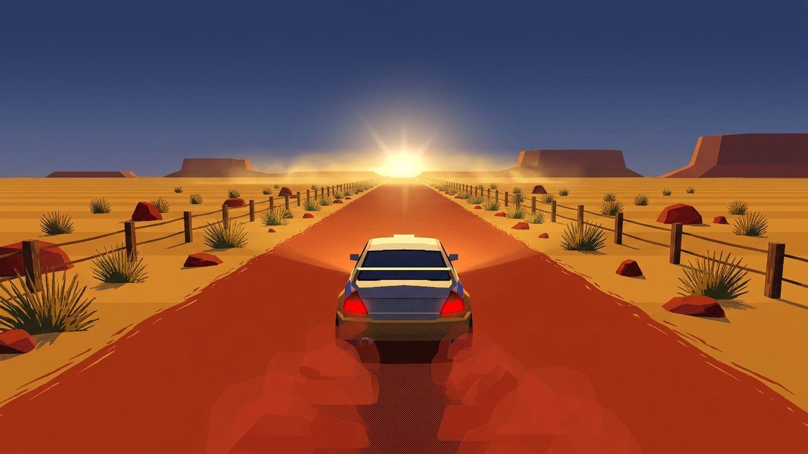
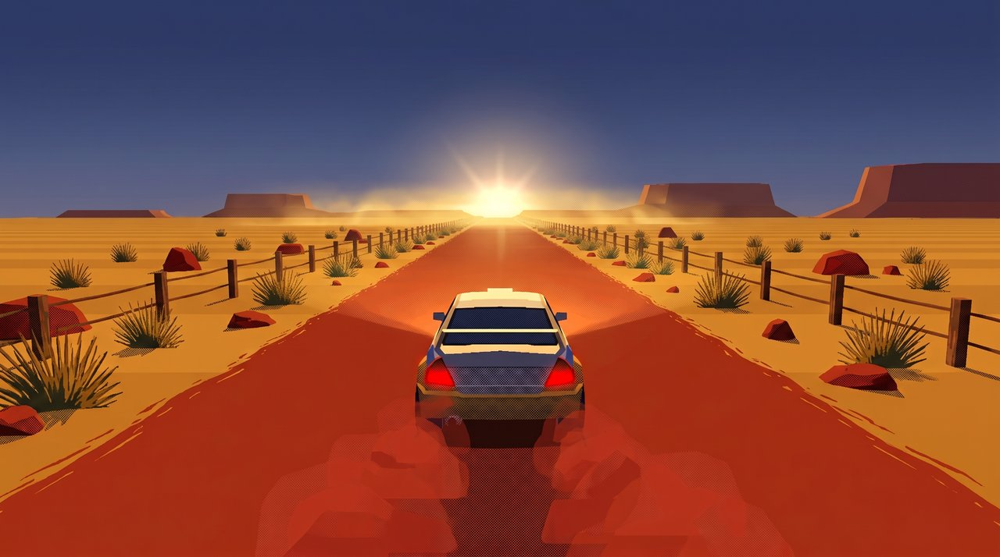
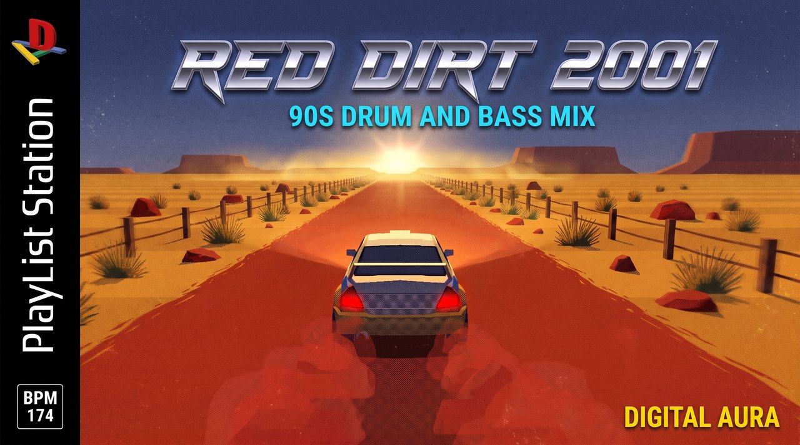

# you're still leading and the sun won't go down (90s drum and bass)

- **Date:** 2026-10-24
- **YouTube:** https://youtu.be/6cEKbcThO8Y (public)
- **Theme:** Outback Dust Run
- **Mix:** 57:33, 26 tracks
- **Loop:** sped up 2.5x, 1.0s seam crossfade
- **Download everything:** [2026-10-24_raw_pack.zip](https://github.com/ctemenes/Music-gen-daily/releases/download/mix-2026-10-24/2026-10-24_raw_pack.zip)

## Files

| File | What | Made with | Size | Full res |
|---|---|---|---|---|
| 01_base_scene_vidiq.png | Base scene from vidIQ, outback red dirt rally road at golden hour | vidIQ vidiq_generate_thumbnail | 1.4 MB | [download](https://github.com/ctemenes/Music-gen-daily/releases/download/mix-2026-10-24/raw_01_base_scene_vidiq.png) |
| 02_clean_frame.png | Clean full-frame recreation used as the loop start and end frame (accepted first try) | Higgsfield generate_image nano_banana_2_1 | 7.0 MB | [download](https://github.com/ctemenes/Music-gen-daily/releases/download/mix-2026-10-24/raw_02_clean_frame.png) |
| 03_thumbnail_playlist_station.png | PlayList Station cover thumbnail used on YouTube (accepted first try) | Higgsfield generate_image nano_banana_pro | 7.7 MB | [download](https://github.com/ctemenes/Music-gen-daily/releases/download/mix-2026-10-24/raw_03_thumbnail_playlist_station.png) |
| 04_loop_raw.mp4 | 15s Kling 3.0 Pro loop clip, start and end frame = clean frame | Higgsfield generate_video kling3_0 pro (preset IN THE DARK declined) | 29.4 MB | [download](https://github.com/ctemenes/Music-gen-daily/releases/download/mix-2026-10-24/raw_04_loop_raw.mp4) |

## Previews

**01_base_scene_vidiq.png**



**02_clean_frame.png**



**03_thumbnail_playlist_station.png**



## Prompts

### 01_base_scene_vidiq.png

vidIQ vidiq_generate_thumbnail, job `job_0a457de6-0494-4b96-81b4-73295fc8d1f0`

```
PS1-era low-poly 3D render with a 2001 racing game look. Rear chase-cam view of one original low-poly rally car (no real badges) centred on a straight red dirt outback road with a central vanishing point, kicking up a red dust plume behind it. Golden hour with a low sun flare on the horizon and heat shimmer. Palette: red earth #B5451B, ochre #D9922E, heat haze gold #F4C95D, dusk blue #2B3A67 sky. Only repeating roadside elements (spinifex clumps, small red rocks, wooden fence posts) and fixed distant scenery (flat-topped mesas, sun, sky). No signs, no buildings, no other vehicles, no bridges. Low-res dithered textures, soft glow, high contrast. No text, no logos, no side panel, no border.
```

### 02_clean_frame.png

Higgsfield generate_image nano_banana_2_1, job `d9ed472b-c558-468e-84fb-076fb6468a64`

```
Recreate this exact scene as a clean full-frame image: the same car in the same position and size, same camera angle, road, scenery, lighting, colours and weather. Remove any text, logos, side panel or border, and remove any one-off roadside landmarks (signs, billboards, buildings, other vehicles), filling those areas with the surrounding scenery. Keep only repeating roadside elements and fixed distant scenery. Keep the PS1-era low-poly 3D look with low-res dithered textures and soft glow. No text, no logos, no letters, no HUD, no border, no watermark.
```

### 03_thumbnail_playlist_station.png

Higgsfield generate_image nano_banana_pro, job `bc0060de-8264-41a5-ae5a-19ce8e5ec993`

```
A flat, front-on video game cover that fills the entire 16:9 frame edge to edge, using exactly the layout of the first reference image: the black vertical spine strip down the left side with the D-A logo from the second reference image at the top (a chunky 3D red capital D standing upright over a yellow bar, a blue bar and a green bar forming a letter A, copied exactly, not any other console logo), the words PlayList Station running vertically up the spine in white, and a small white-outlined box reading BPM 174 at the bottom of the spine. The rest of the frame is the cover art: the scene from the third reference image, made gritty with film grain and a sense of speed. Across the top, a large chrome slanted racing-game title in the same style as the first reference: RED DIRT 2001. Directly under it, smaller, in electric cyan capitals: 90S DRUM AND BASS MIX. Bottom right corner: DIGITAL AURA in small bold yellow capitals. Spell all text exactly as written. No other console, publisher or rating logos, no ESRB, no Sony, no other text.
```

### 04_loop_raw.mp4

Higgsfield generate_video kling3_0 pro (preset IN THE DARK declined), job `83d5554b-205b-475d-aa7b-88de22ecb392`

```
Locked rear chase camera following the rally car as it races flat out at very high speed down the straight red dirt road. The car holds its exact position and size in the frame for the whole shot while the red dirt road surface, spinifex clumps, red rocks and wooden fence posts rush past toward the camera fast, with motion blur and a constant high speed. A red dust plume keeps billowing from the rear wheels. Distant mesas and the low golden sun stay fixed on the horizon. Heat shimmer and sun glow keep moving. No cuts, no camera shake or drift, no signs, buildings, vehicles or new objects, PS1-era low-poly game look throughout. The final frame matches the first frame exactly so the clip loops seamlessly.
```

## Notes

- Title scores (vidIQ, long): you're still leading and the sun won't go down (90s drum and bass) 96 (picked); red dirt and nobody's caught you in three laps (ps1 racing dnb) 93; you're the last car still racing at golden hour (ps1 racing dnb) 93; HEAT HAZE 2001 (intelligent dnb night drive) 80; RED DIRT RUN 2001 (ps1 racing dnb) 74; DUST PLUME 2001 (atmospheric drum and bass) 73
- Cover hook: RED DIRT 2001. Cover subtitle: 90S DRUM AND BASS MIX. Spine BPM 174 (median).
- Higgsfield credits spent: 30.25 (clean frame 2, thumbnail 2, video 26.25). YouTube: https://youtu.be/6cEKbcThO8Y

## Also in this folder

`description.txt` and `tracklist.txt` (as uploaded), `youtube.json` (upload record), `brief.json` (the day's theme and music brief).
